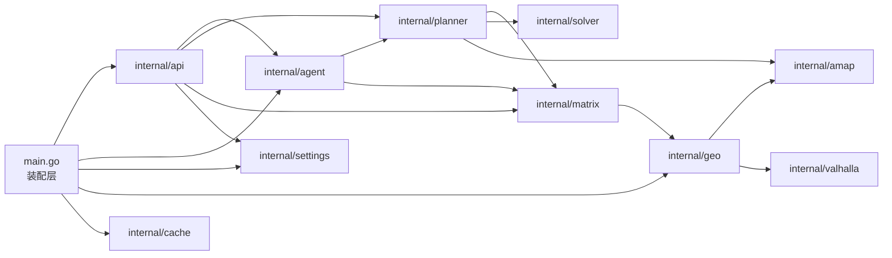
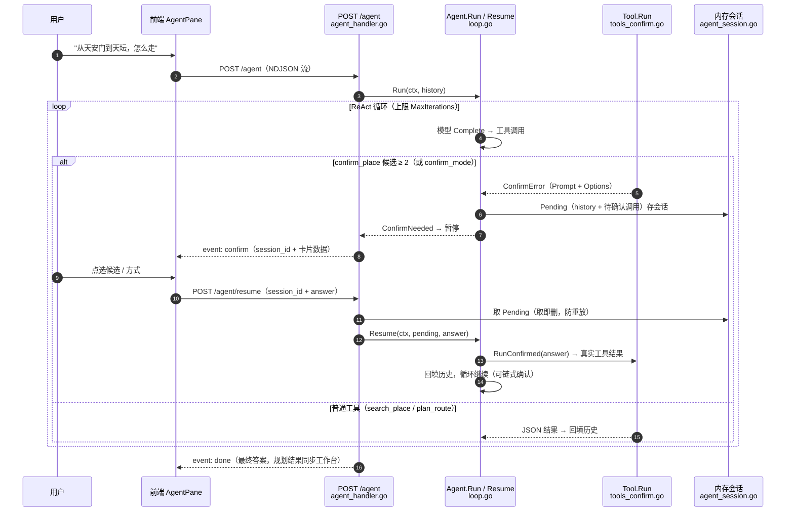
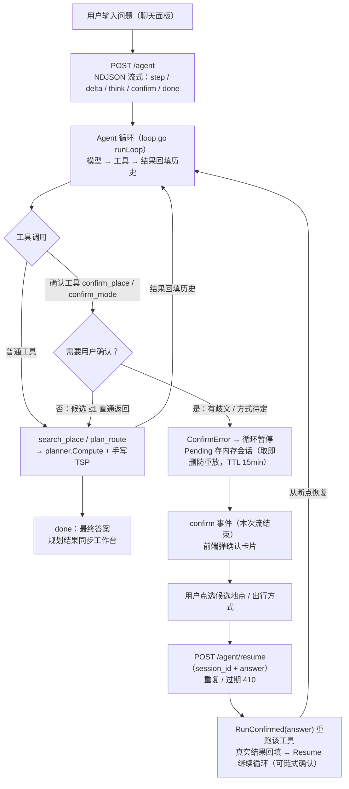
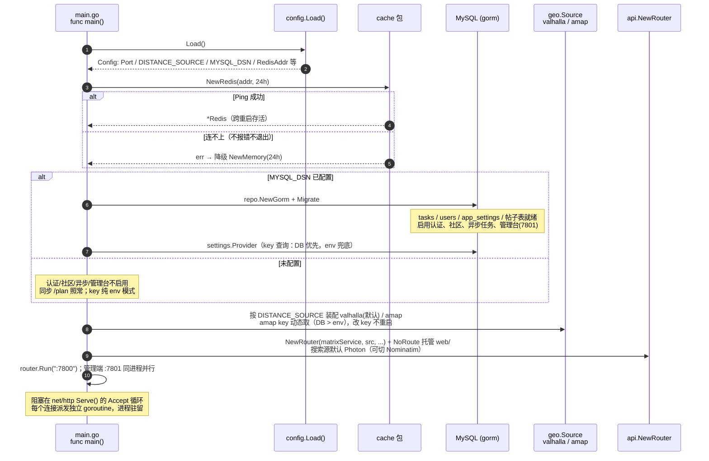
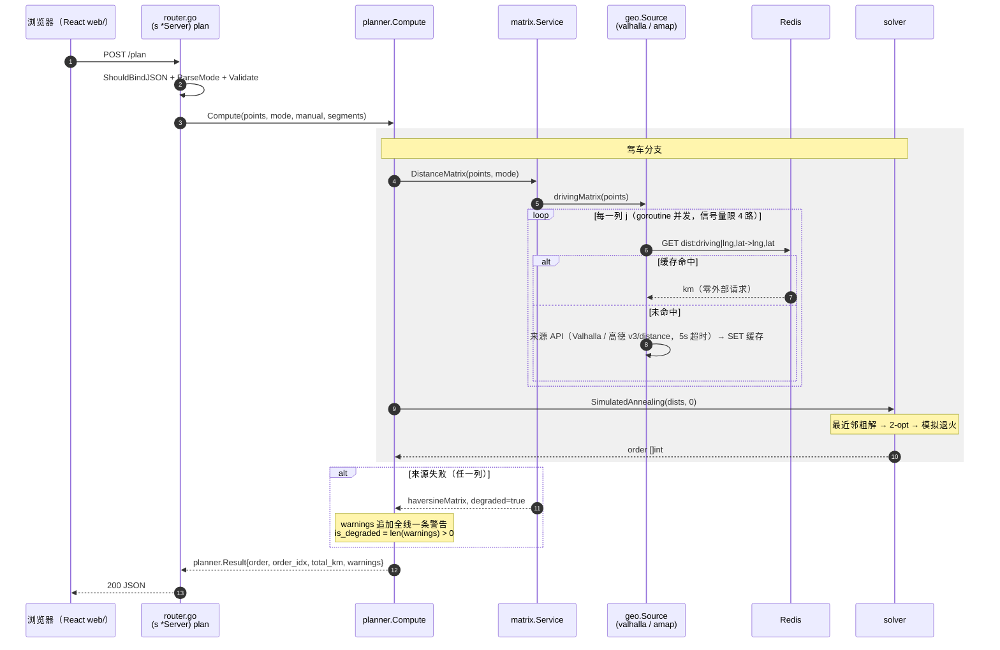
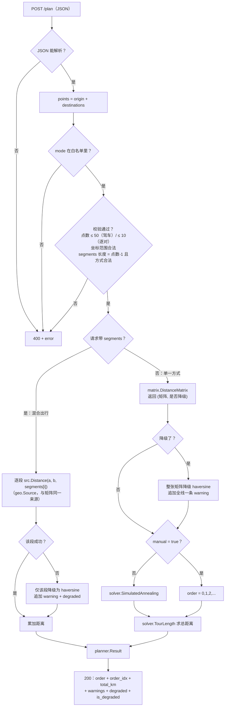

# Route66

**多点路线规划服务 · Go · React 19 · 手写 TSP · 内置 ReAct 智能体**

`Go` · `Gin` · `OpenStreetMap` · `Valhalla` · `手写TSP` · `Redis` · `React 19` · `ReAct Agent`

[](https://go.dev/)
[](https://gin-gonic.com/)
[](https://www.openstreetmap.org/)
[](https://redis.io/)
[](LICENSE)

---

## 简介

Route66 是一个多点路径规划服务：输入一串地点，自动计算总距离最短的访问顺序（TSP），
支持驾车 / 步行 / 公交三种出行方式，以及每段路独立选择方式的混合出行。
距离与底图提供两种模式：**开源模式**（Valhalla 自托管 + OSM，可公开部署）与
**高德模式**（高德 Web 服务 + 高德瓦片，个人使用），`.env` 一个开关切换；
来源不可用时自动降级为直线估算并在响应中显式标注。

后端为 Go 单进程（Gin + **SQLite** + Redis），Web 前端为 React 19 + Vite，由 Go 进程同源托管。
同一套后端服务多类客户端：Web 浏览器、React Native 跨端 App（`app/`）、Electron 桌面壳（`desktop/`）。
内置 ReAct 智能体（RouteBot）：LLM 自主组合「地点搜索」「路线规划」等工具完成规划，
在歧义地点与出行方式两处暂停并弹卡片等用户确认（HITL，人工副驾），确认后从断点恢复继续规划。

> **2026-11 大版本**：存储从 MySQL 切换为纯 Go SQLite（零外部数据库依赖）；
> 密码登录移除，认证改为 **Casdoor SSO / 本地免登录双模式**；
> 新增 **MCP 优先模式**——用户绑定自己的地图 MCP 服务，key 不出浏览器，服务器零 key 运行。
> 详见下方「部署模式与 MCP（新版）」。

## 功能特性

| 特性 | 说明 |
|---|---|
| TSP 路径优化 | 手写求解器：最近邻 → 2-opt → 模拟退火 |
| 多出行方式 | 驾车 / 步行 / 公交，各走对应来源接口 |
| 混合出行 | 每段路独立指定方式（`segments` 参数） |
| 双地图模式 | 开源（Valhalla + OSM）/ 高德（Web 服务 + 瓦片）一个开关切换，前端底图与坐标投影自动跟随 |
| 智能 Agent + HITL | 手写 ReAct 循环：歧义地点、出行方式暂停弹卡等确认，确认后从断点恢复继续规划 |
| 社区 Feed | 路线笔记发布、点赞评论、路线快照分享与一键导入 |
| 认证双模式 | 联合部署走 Casdoor OIDC（PKCE + 白名单 + 换账号）；独立部署本地免登录。密码体系已移除 |
| **MCP 优先** | 用户绑定自己的地图 MCP（高德/腾讯），key 只存浏览器；绑定后搜索/矩阵/轨迹全走用户设备 |
| 异步任务 | Redis Stream 消费组 + 后台 worker，长任务提交后轮询 |
| 拖拽排序 | 原生 HTML5 DnD，零第三方依赖 |
| 双重缓存 | Redis 优先，不可用降级进程内 map，TTL 24h |
| 优雅降级 | 来源失败回退直线估算，降级信息随响应回传（`is_degraded`） |
| 多端交付 | Web（React 19）/ 跨端 App（React Native）/ 桌面（Electron 壳）共用同一后端 |

## 部署模式与 MCP（2026-11 新版）

### 存储：SQLite 统一承载

`SQLITE_PATH`（默认 `data/route66.db`）一个文件承载用户、会话、社区帖子、任务与配置。
纯 Go 驱动（glebarez/sqlite），WAL + busy_timeout + 单写连接；**不再需要 MySQL/PostgreSQL**。
备份 = 复制这一个文件；迁移服务器 = 拷贝 `data/` 目录。

### 认证双模式

| 模式 | 开关 | 行为 |
|---|---|---|
| **独立部署**（默认） | `NO_AUTH=true`（默认） | 无登录，所有请求以「本地用户」（admin）身份放行，适合本机/内网 |
| **联合部署** | `NO_AUTH=false` + 下表 OIDC 配置 | 全部业务 API 有登录墙；Casdoor 认证，白名单准入 |

联合部署环境变量：

| 变量 | 说明 |
|---|---|
| `OIDC_ISSUER` | Casdoor/OIDC issuer，如 `https://sso.example.com` |
| `OIDC_CLIENT_ID` / `OIDC_CLIENT_SECRET` | OIDC 应用凭据 |
| `OIDC_REDIRECT_URL` | 完整回调地址，如 `https://route66.example.com/auth/callback` |
| `OIDC_ADMIN_SUB` | 管理员 sub：自动入白名单，建档即 admin 角色 |
| `OIDC_ALLOWED_SUBS` | 可选，逗号分隔的额外允许登录 sub |

实现要点：Authorization Code + PKCE S256 + 一次性 state（10 分钟过期，双提交 cookie 比对）；
id_token 验签失败自动重建 provider 刷新 JWKS 重试一次；
退出登录跳 `/auth/login?prompt=login` —— SSO 会话有效也强制显示登录表单，可换账号。

### MCP 优先模式（用户自绑地图服务，服务器零 key）

在 RouteBot 面板绑定自己的地图 MCP（高德 `mcp.amap.com` / 腾讯 `mcp.map.qq.com`，
厂商控制台免费申请 key）。**key 只存浏览器 localStorage，永不上传服务器。**

绑定后的主规划链路：

```
用户设备直连厂商取距离矩阵（MCP tools）
  → POST /plan/solve（后端纯计算 TSP 解序，无 key 无外部依赖）
  → 用户设备直连厂商取逐段轨迹画线
```

RouteBot 智能体路径同理（search/matrix/legs 三阶段委托执行，HITL 不变）。
未绑定用户走 `/plan` 服务器端来源（Valhalla 或环境变量里的高德 key）作为降级。

### 一键部署

```bash
./scripts/deploy.sh   # 前端构建 → 交叉编译 Linux 二进制 → 上传 → systemctl 重启
```

---

## 架构

```
  Web 浏览器 / RN App /          ┌─────────────────────────────────────┐
  Electron 桌面                  │           Go 后端 (Gin)              │
  ┌──────────────┐              │  ┌─────────────────────────────┐    │      ┌────────────────┐
  │ React 19 /   │              │  │ /plan /agent /search /route │    │─────▶│ 高德 Web 服务   │
  │ RN + WebView │─────HTTP────▶│  │ /auth /community (API 编排)  │    │      │ 或 Valhalla    │
  │ + Leaflet    │              │  └────────────┬────────────────┘    │      │ + Photon       │
  └──────────────┘              │  ┌────────────▼────────────────┐    │      └────────────────┘
                                │  │ matrix (距离) / solver (TSP) │    │      ┌────────────────┐
  ┌──────────────┐              │  │ agent (ReAct + HITL 会话)    │    │◀────▶│ Redis 距离缓存  │
  │ 管理台 :7801 │─────────────▶│  └─────────────────────────────┘    │      └────────────────┘
  └──────────────┘              │  ┌─────────────────────────────┐    │
                                │  │ MySQL (gorm)：用户/帖子/key 配置│    │
                                │  └─────────────────────────────┘    │
                                └─────────────────────────────────────┘
```

分层设计：`api`(编排) / `planner`(解算) / `matrix`(距离来源) / `solver`(TSP) /
`agent`(智能体) / `geo`(来源接口) / `cache`(缓存抽象)——低耦合，面向接口。
距离来源、求解算法、缓存实现的替换均不影响调用方。

**包依赖关系**（单向无环，`internal/` 强制封装）：



| 依赖规则 | 原因 |
|---|---|
| 依赖方向单向，无环 | 保证包可独立测试、可独立演进为服务 |
| `geo.Source` 是距离/搜索唯一接口，`amap` / `valhalla` 各自实现 | 双模式切换只动装配层，业务包零感知 |
| `solver` 只吃 `[][]float64`，不认识任何来源 | 算法与数据来源解耦 |
| `agent` 复用 `planner.Compute`，不自算路线 | AI 只做编排，"最优"交给确定性算法（可测试、毫秒级） |
| `api` 不直接计算距离/排序 | 编排层只做参数校验与串联 |
| key/LLM 配置统一走 `settings`（DB 优先，env 兜底） | 管理台热更换，改 key 不重启 |

## 快速开始

### 前置条件

- Go 1.26+
- （可选）Redis 7 —— 不装也能跑，自动降级内存缓存
- （可选）Node 20+ —— 仅构建/修改前端时需要（源码在 `frontend/`）
- （可选）MySQL 8 + Docker —— 启用认证、社区、异步任务与管理台

### 1. 下载地图数据（Valhalla）

默认距离来源是自托管的 [Valhalla](https://github.com/valhalla/valhalla)（OpenStreetMap 路网），
不需要申请任何 key：

```bash
bash scripts/fetch-osm.sh   # 下载中国 OSM 提取数据（约 1.1GB，只需一次）
```

### 2. 启动

```bash
# 配置：复制示例即可，默认值可直接跑（零 key 零注册）
cp .env.example .env

# 起外部依赖（Valhalla + PostgreSQL + Redis；后两者可选，不装也能跑）
docker compose up -d

# 起后端
set -a; source .env; set +a
go run .

# 打开页面
open http://localhost:7800
```

> Valhalla 容器首次启动会自动建瓦片（视机器 20~60 分钟），期间 `/plan` 会返回
> 直线估算并在 `is_degraded` 显式标注；瓦片就绪后自动恢复真实路网，无需重启。

### 2.5 登录系统 + 管理台

> ⚠️ 本节描述的 MySQL 登录体系已于 2026-11 移除，现为 Casdoor SSO / 本地免登录双模式，
> 见上方「部署模式与 MCP（新版）」。管理台（`:7801`）保留：SSO 模式下 admin 角色可进。

`docker compose up -d mysql` 等 MySQL 相关内容仅作历史参考，当前版本不需要。

| 端口 | 内容 |
|---|---|
| `:7800` | 用户端（规划界面 + `/auth/*` + `/config/public` 下发 JS key） |
| `:7801` | 管理台（key 掩码查看/热更换、用户列表；非 admin 一律 403） |

- **key 优先级**：管理台(DB) > `.env` 兜底；管理台修改立即生效，无需重启
- **安全模型**：REST key 仅存服务端；JS key 经 `/config/public` 下发；
  密码 bcrypt 存储；登录失败统一文案（防用户名枚举）；会话为 HttpOnly cookie，
  cookie 不按端口隔离，故 7801 每条路由强制 `RequireAdmin`

### 3. 使用

1. 搜索地名或直接在地图上点选添加地点
2. 拖拽调整顺序（或交给算法自动优化）
3. 需要时为每段路指定出行方式
4. 开始规划，查看路线与总距离

### 4. 前端构建

`frontend/` 是 React 源码，构建产物输出到 `web/`（gitignore，不进仓库），由 Go 托管在站点根路径：

```bash
cd frontend
npm install
npm run build      # 产物输出到 ../web/（index.html + assets/）
```

开发时使用 Vite 开发服务器（热更新）：

```bash
cd frontend
npm run dev        # http://localhost:5173, /plan /search /route 已代理到 7800
```

> `vite.config.js` 里的 `base` 与 `outDir` 必须指向同一位置：
> `base` 决定 HTML 中资源路径写法，`outDir` 决定产物落盘位置，只改其一会导致资源 404。
>
> Go 侧托管逻辑在 `router.go`：`r.NoRoute(http.FileServer(http.Dir("web")))`，
> 产物落在 `web/` 即出现在根路径，无需新增路由。

## RN 跨端 App（app/）

`app/` 是 React Native 0.88 跨端应用（iOS / macOS / Android / Windows），
复用同一套 Go 后端：规划核心（搜索 / 加点 / 混合出行 / TSP 规划 / 画线 / 降级警告）已对齐 Web 版，
地图用 WebView 内嵌 Leaflet，设计 token 与 Web 前端同源。
构建步骤与各端前置条件见 [docs/rn-app.md](docs/rn-app.md)。

```bash
cd app && npm install && npm start   # Metro 开发服务器（8081）
```

桌面端另有 **Electron 壳**（`desktop/`）：窗口直接加载 Go 托管的 web 版，业务代码零改动、
零原生构建依赖（不需要 Xcode / Visual Studio），macOS 已验证，Windows 同壳出 `.exe`。

## 部署

`docker compose up -d` 已覆盖全部外部依赖，应用本身是单个 Go 二进制 + 静态前端：

```bash
# 0. 距离数据（首次部署需要，约 1.1GB）
bash scripts/fetch-osm.sh

# 1. 前端构建（产物在 web/，由 Go 托管，不进仓库）
cd frontend && npm install && npm run build

# 2. 编译后端
go build -o route66 .

# 3. 带配置启动（端口、key、数据库连接都来自环境变量）
cp .env.example .env   # 编辑后：
set -a; source .env; set +a
./route66
```

对公网开放时：

- 前面加一层反向代理（Nginx / Caddy）做 TLS；`ADMIN_PASSWORD` 务必换强密码
- **key 自备（BYOK）**：每个部署者使用自己申请的高德 key，调用成本与合规责任都落在部署者一侧，项目本身不代理、不转售任何地图服务
- MySQL 数据在 compose 卷 `mysqldata` 中，`docker compose down -v` 才会删除

## 距离与搜索来源

距离来源即"地图模式"，`DISTANCE_SOURCE` 是唯一开关：

| 模式 | `DISTANCE_SOURCE` | 距离 / 轨迹 | 前端底图 | 坐标系 |
|---|---|---|---|---|
| 开源模式（默认） | `valhalla` | Valhalla（自托管，`VALHALLA_URL`） | OpenStreetMap（openstreetmap.de） | WGS-84 |
| 高德模式 | `amap`（需 `AMAP_KEY`） | 高德 Web 服务 API | 高德 XYZ 瓦片 | 数据层 WGS-84，渲染层 GCJ-02 |

- 当前模式经 `GET /config/public` 的 `mode` 字段下发，前端据此切换底图并在渲染层
  做 WGS-84 ↔ GCJ-02 转换（`frontend/src/gcj02.js`），点列表、路线、点击取点的
  数据契约不变 —— 换模式只影响底图与渲染，API 与存储始终 WGS-84（经度在前）。
- 高德作为遗留来源保留：`internal/amap` 及其测试原样可用（key 从管理台 DB 读取，
  env 兜底，改 key 不重启生效）。高德 API 服务条款限制商用部署，上线请用开源模式。
- 搜索不随模式切换，固定 Photon（`PHOTON_URL`，大陆可达；`SEARCH_SOURCE=nominatim`
  可切 Nominatim）。公交模式两种来源都无真实公交路网轨迹，自动降级直线估算并逐段标注。
- 全部距离来源失败时降级 haversine 直线估算，`is_degraded=true`。

## API

所有业务接口位于登录墙之后（装配了 PostgreSQL 时需先 `POST /auth/login`）。

### `POST /plan` —— 规划路线

```bash
curl -X POST http://localhost:7800/plan \
  -H 'Content-Type: application/json' \
  -d '{
    "origin": {"name":"天安门","lat":39.9087,"lng":116.3975},
    "destinations": [
      {"name":"故宫","lat":39.9163,"lng":116.3972},
      {"name":"天坛","lat":39.8822,"lng":116.4066}
    ],
    "mode": "driving",
    "segments": ["walking","transit"]
  }'
```

```json
{"order": ["天安门","故宫","天坛"],
 "order_idx": [0,1,2],
 "total_km": 6.8,
 "warnings": [],
 "degraded": [],
 "is_degraded": false}
```

> `order` 与 `order_idx` 同时返回：名字不是标识符（同名地点会重复），名字供人读，下标供机器定位。

| 参数 | 说明 |
|---|---|
| `origin` / `destinations` | 起点 + 目的地点列表 |
| `mode` | 全局出行方式（默认 `driving`）；白名单校验，非法值 400 |
| `segments` | 混合出行，`segments[i]` = 第 i 段方式（长度 = 点数-1） |
| `manual` | `true` 按列表顺序，跳过 TSP |

**点数上限按出行路径分档**：

| 路径 | 上限 | 原因 |
|---|---|---|
| 单一驾车 | 50 | `v3/distance` 批量接口，n 个点仅需 n 次请求 |
| 步行 / 公交 / 混合出行 | 10 | 逐对请求 + 350ms 节流，10 点约 32s |

降级显式回传：`is_degraded=true` + `warnings` 标明哪些数值是直线估算。

### `GET /search?q=关键词&city=可选` —— 地名搜索

```bash
curl "http://localhost:7800/search?q=故宫&city=北京"
```

```json
{"places":[{"name":"故宫博物院","address":"景山前街4号","lat":39.9163,"lng":116.3972}]}
```

### `GET /route?origin=lng,lat&dest=lng,lat&mode=driving` —— 路网轨迹

`origin` / `dest` 为 `经度,纬度` 顺序（与高德一致）。

```bash
curl "http://localhost:7800/route?origin=116.3975,39.9087&dest=116.3972,39.9163&mode=driving"
```

返回 `[lng,lat]` 坐标数组，前端拼为折线。`mode` 非法返回 400；`mode=transit` 返回空数组
（公交无连续轨迹，前端退化为直线，属业务事实而非错误）。

## 智能 Agent（手写 ReAct + HITL）

`internal/agent/` 实现一个手写的最小智能体：不依赖任何 Agent 框架，
核心循环为「调模型 → 执行模型请求的工具 → 结果回填历史 → 循环」，
直到模型返回纯文本即最终答案。

在核心循环之上实现了**暂停-恢复式 HITL（人工副驾）**：
`confirm_place`（歧义地点确认）与 `confirm_mode`（出行方式确认）两类确认工具
在需要人拍板时返回确认请求，循环暂停并把完整对话状态（含工具消息）存入内存会话，
前端弹出确认卡片；用户点选后 `POST /agent/resume` 从断点恢复，循环继续。
无歧义时（候选 0/1 个）确认工具直通返回，不打扰用户。

| 文件 | 角色 | 说明 |
|---|---|---|
| `internal/agent/types.go` | 类型 | `Message` / `ToolCall` / `ToolSpec`，对应 OpenAI Chat 协议消息形状 |
| `internal/agent/model.go` | 模型 | `Model` 接口 + `OpenAICompatible` 实现（DeepSeek / Kimi / Qwen 兼容模式 / Ollama，换厂商只改 BaseURL 与 Model） |
| `internal/agent/tool.go` | 工具 | `Tool` 接口：`Spec()` 提供说明书，`Run()` 执行 |
| `internal/agent/loop.go` | 循环 | `Run()` / `Resume()` 共用 `runLoop`：ReAct 循环 + `MaxIterations` 防失控 + 流式回调；捕获确认请求以 `*ConfirmNeeded` 暂停返回 |
| `internal/agent/hitl.go` | HITL 协议 | `ConfirmError` / `Confirmable` / `Pending` / `ConfirmNeeded`：暂停-恢复的契约 |
| `internal/agent/tools_confirm.go` | 确认工具 | `confirm_place`（候选 0/1 直通，≥2 出卡片）、`confirm_mode`（总是出卡片），实现 `Confirmable.RunConfirmed` |
| `internal/agent/tools_plan.go` | 业务工具 | `search_place`（地名搜索）、`plan_route`（直通 `planner.Compute`） |
| `internal/api/agent_session.go` | 会话 | 内存 Pending 会话：取即删防重放，TTL 15 分钟 |
| `internal/api/agent_handler.go` | 接口 | `POST /agent`（NDJSON 流式：step / delta / think / confirm / error / done）+ `POST /agent/resume`（重复/过期 410） |

### 调用时序（含 HITL）



### 流程总览

与 `docs/route66.drawio` 第 2 页同一张流程（可拖拽编辑的版本在 drawio 里，GitHub 只渲染 mermaid，故此处同步一份）：



### 设计要点

- **循环不做决策**：决策完全来自模型的每轮输出，`loop.go` 只负责执行、历史管理与防失控
- **AI 不算路线**：规划委托 `planner.Compute`（与同步接口、异步 worker 同一条解算链），
  "最优"交给手写 TSP——确定性算法可测试、毫秒级，模型只做编排
- **确认即暂停**：确认类工具第一次执行只生成确认请求（不出结果），
  `RunConfirmed(answer)` 才是真正执行；恢复后可能再次触发确认，天然支持链式确认
- **会话防重放**：Pending 取即删，重复 / 过期 resume 一律 410
- **失败喂回而非中断**：未知工具、非法参数、上游超时转为错误文本回填历史，由模型自行纠正
- **可测试性**：循环仅依赖 `Model` / `Tool` 两个小接口；HITL 链路（链式确认、410、
  历史对账）有独立测试覆盖（`-race` 全绿）

### 运行

LLM 配置走 `settings`（管理台 DB 优先，`.env` 兜底）：

```bash
# .env 兜底方式
set -a; source .env; set +a
export LLM_BASE_URL=https://api.deepseek.com   # 任选 OpenAI 兼容服务
export LLM_API_KEY=sk-xxx
export LLM_MODEL=deepseek-chat                 # 以服务方模型列表为准
go run .    # 起服务，前端聊天面板即 RouteBot
```

也可以独立跑 CLI 版（与 7800 服务互不依赖，适合调试循环本身）：

```bash
go run ./cmd/agent-demo "帮我规划一条从天安门出发,途经故宫再到天坛的驾车路线"
```

距离来源未就绪时规划走直线估算，agent 会在回答中说明。

## 运行时：启动与请求流转

### 启动时序（`main.go` 为装配层）



- Redis / MySQL 连接失败都不报错不退出，各自降级或关闭对应功能，服务其余部分照常运行
- 装配出的 `matrixService` / `geo.Source` / `settings.Provider` 为进程级单例，所有请求共享（缓存跨请求命中的前提）
- `router.Run()` 阻塞在标准库 `net/http.Serve()` 的 Accept 循环，每个连接派发独立 goroutine

### 一次 `/plan` 请求的时序



### `/plan` 内部调用链

```
(s *Server) plan(c *gin.Context)                                     api/router.go
├─ planner.ParseMode(s string) → (model.Mode, error)                 mode 白名单，空 = 默认 driving
├─ planner.Validate(points, mode, segments) error                    点数上限 / 坐标范围 / segments 长度
│
├─ planner.Compute(points, mode, manual, segments, src) → Result      internal/planner/planner.go
│   ├─ (s *Service) DistanceMatrix(points, mode)
│   │            → (dists [][]float64, degraded bool)                internal/matrix/matrix.go
│   │   ├─ geo.Source（main 装配：valhalla 默认 / DISTANCE_SOURCE=amap 门控）
│   │   │    ├─ valhalla.Client.DistanceMatrix(points, mode)          自托管路网 sources→targets
│   │   │    └─ amap.Client（高德模式）
│   │   │       ├─ drivingMatrix(points)                              驾车：逐列并发（信号量限 4 路）
│   │   │       │    └─ fetchColumn → v3/distance（5s 超时，Redis 缓存）
│   │   │       ├─ pairwiseMatrix(points, mode)                       步行/公交逐对 + 350ms 节流
│   │   │       └─ wrapColumnErr(col, err) error                      CUQPS 限流错误附处理提示
│   │   └─ haversineMatrix(points)                                    降级：全直线矩阵
│   ├─ solver.SimulatedAnnealing(dists, 0) → []int                    internal/solver/tsp.go
│   │    ├─ NearestNeighbor(dists, start) → []int
│   │    └─ TwoOpt(dists, order) → []int
│   └─ solver.TourLength(dists, order) → float64
│
└─ matrix.Haversine(a, b model.Point) → float64                      混合出行单段降级复用
```

## 架构详解

### TSP 求解器

求解管线为三级：最近邻贪心粗解 → 2-opt 局部搜索 → 模拟退火跳出局部最优。
实测（广州三点基准，驾车）：最近邻 322.44 km → +2-opt 289.14 km → +模拟退火 285.62 km。
2-opt 的好坏判据使用精确的 `TourLength` 差值而非「边界两条边」简化公式——
驾车真实路网距离矩阵不对称（单行道/禁转），简化公式会漏掉内部边翻转的收益。

### `POST /plan` 数据流



两条业务约束：

- **混合出行不做 TSP**：每段方式不同则段间距离不可比，统一口径的距离矩阵不存在，全局最优顺序无从谈起，因此固定按列表顺序逐段计算
- **`order` 与 `order_idx` 同时返回**：名字供人读，下标供机器定位（前端按下标画线）

### 缓存与降级

缓存 key 携带出行方式（`driving|lng,lat->lng,lat`），Redis 侧再加 `dist:` 前缀——
同一地点对不同方式距离不同，共用 key 会互相污染。

| 故障点 | 典型原因 | 降级策略 | 日志前缀 |
|---|---|---|---|
| Redis 连接 | 进程未起 / 网络不通 | → 进程内 Memory 缓存（不产生用户侧警告） | `redis unavailable` |
| 距离来源（矩阵） | Valhalla 未启动 / 高德配额超限、超时 | → 整张矩阵 haversine，回传 `is_degraded=true` + 全线 warning | `[matrix] ... falling back` |
| 距离来源（混合出行某段） | 单段失败 | → 仅该段 haversine，该段名进 `degraded` | `[plan] 路段 ... 失败` |
| 非法 `mode` | 调用方拼错 | → 400 拒绝（参数错误不降级） | — |
| `/route` 轨迹 | 公交无连续轨迹 | → 返回空数组，前端该段画直线 | — |

降级可见性设计：`matrix.DistanceMatrix` 的第二个返回值 `degraded` 将「矩阵来自降级」这一事实
带出包外——日志仅服务端可见，降级信息必须随 HTTP 响应回传。`is_degraded` 统一取
`len(warnings) > 0`（单一真相源）。注意区分：来源本身未就绪（开源模式 Valhalla 未部署 /
高德模式未配 key）时走 haversine 是预期行为，不产生警告；来源装配了但调用失败才是降级。

缓存命中效果（广州塔 → 白云山 → 长隆，3 点驾车）：
首次 3 次高德请求约 0.33s；二次同路线 0 次约 0.06s；重启 Go 进程后仍 0 次（Redis 跨进程存活）。

### 设计模式落点

| 模式 | 落点 |
|---|---|
| 依赖注入 | `main.go` 装配全部依赖，其他包不自建外部资源 |
| 适配器 | `Cache` 接口适配 Redis / Memory；`geo.Source` 接口适配 Valhalla / 高德，测试指向本地假服务器 |
| 策略 | `DISTANCE_SOURCE` 选择距离实现；出行方式对应不同上游接口与路径 |
| 模板方法 | TSP 固定管线：最近邻 → 2-opt → 模拟退火 |
| 代理 | `/search`、`/route` 代理上游来源（Photon / Valhalla / 高德），凭据不进前端 |
| Repository | `TaskRepo` 接口隔离存储，单测注入内存实现 |

### 高德接口路径表

以下常量收口在 `internal/amap/amap.go`（`DISTANCE_SOURCE=amap` 高德模式的客户端；开源模式不经过这些接口）：

| 常量 | 路径 | 用途 | 备注 |
|---|---|---|---|
| `pathDistance` | `/v3/distance` | 驾车距离矩阵 | 批量：多起点 → 单终点 |
| `pathDrivingDir` | `/v3/direction/driving` | 驾车单段距离 / 轨迹 | 含 `steps[].polyline` |
| `pathWalkingV5` | `/v5/direction/walking` | 步行单段距离 | 数据准，不返回轨迹 |
| `pathWalkingV3` | `/v3/direction/walking` | 步行轨迹 | 画线专用（v5 无轨迹） |
| `pathTransitDir` | `/v3/direction/transit/integrated` | 公交单段距离 | 轨迹不连续，无 polyline |
| `pathPlaceText` | `/v3/place/text` | 关键词搜索 | `/search` 与 agent 的 `search_place` |

> 步行距离用 v5（数据准），轨迹只能用 v3（v5 不返回坐标）——此类差异依赖
> `scripts/smoke.sh` 真实请求验证，`httptest` 无法覆盖真实 API 行为。

## 项目结构

```
route66/
├── main.go                 # 装配层:读配置、组装、启动
├── internal/
│   ├── api/                # Gin 路由: /plan /agent /search /route /auth /community + 编排
│   ├── agent/              # 手写 ReAct 智能体:loop(Run/Resume) + model(OpenAI兼容) + tools(业务+确认)
│   ├── auth/               # 用户系统:注册/登录/会话(cookie) + 中间件
│   ├── community/          # 社区 Feed:帖子/点赞/评论(GORM)
│   ├── planner/            # 业务规则收口:Validate + Compute(同步接口/worker/agent 共用)
│   ├── matrix/             # 距离矩阵(geo.Source → haversine 降级并上报)
│   ├── solver/             # 手写 TSP:最近邻→2-opt→模拟退火
│   ├── geo/                # 距离/搜索统一接口:Kind/HasAPIKey + 双模式契约
│   ├── valhalla/           # 开源模式:自托管 Valhalla 客户端(默认)
│   ├── amap/               # 高德模式:Web 服务客户端(DISTANCE_SOURCE=amap 门控)
│   ├── photon/             # 搜索来源:Photon 客户端(默认)
│   ├── nominatim/          # 搜索来源:Nominatim 客户端(可选)
│   ├── cache/              # 缓存抽象:内存 / Redis
│   ├── queue/              # Redis Stream 任务队列(消费组 + ACK)
│   ├── worker/             # 异步规划后台消费者
│   ├── repo/               # MySQL 持久化(GORM):tasks/users
│   ├── settings/           # 配置中心:高德/LLM key 存 DB,管理台热更换
│   ├── config/             # 环境变量配置
│   └── model/              # Point / Place / Mode
├── cmd/
│   └── agent-demo/         # agent 演示入口(独立 main)
├── frontend/               # Web 前端源码(React 19 + Vite)
│   ├── src/
│   │   ├── App.jsx             # 组合根
│   │   ├── api.js              # 后端接口唯一出口(fetch 封装 + 错误归一化 + Agent NDJSON 解析)
│   │   ├── gcj02.js            # WGS-84 ↔ GCJ-02 坐标转换(高德模式渲染用)
│   │   ├── mapMode.js          # 地图模式单例(/config/public 下发,App 启动写入)
│   │   ├── theme.js            # 设计变量的 JS 侧(地图折线使用)
│   │   ├── components/         # 组件(AgentPane 含 HITL 确认卡)
│   │   ├── hooks/              # usePoints / useLeaflet / usePlan / useAuth / useAgent ...
│   │   └── styles/             # tokens.css + app.css
│   ├── vite.config.js          # base:'/' + outDir:'../web' + dev 代理到 7800
│   └── package.json
├── admin/                  # 管理台(原生 HTML 单页)
├── app/                    # RN 跨端 App(iOS/macOS/Android/Windows,见 docs/rn-app.md)
├── desktop/                # Electron 桌面壳(包装 web 版,main.js 一屏加载 7800)
├── web/                    # 前端构建产物(gitignore)
├── docs/                   # rn-app.md(四端构建)、route66.drawio(Agent 流程图)
└── scripts/smoke.sh        # 真实 key 冒烟测试
```

前端地图默认视野为北京（`frontend/src/theme.js` 的 `DEFAULT_CENTER = [116.397, 39.909]`），
坐标全链路 WGS-84，高德模式下仅渲染层经 `gcj02.js` 投影。

## 排查

配 key 涉及两处位置、多类凭据，常见问题按现象对号入座：

| 现象 | 原因 | 处理 |
|---|---|---|
| 总距离明显偏小、呈直线，`is_degraded=true` | Valhalla 未启动 / 瓦片还在构建 | `docker compose up -d valhalla`，等待建片完成 |
| `/plan` 报「距离来源不可用,混合出行不可用」 | 距离来源未装配 | 配置 `VALHALLA_URL` 或切 `DISTANCE_SOURCE=amap` |
| `/search` 报「搜索服务未装配」 | 后端未配置搜索来源 | 确认 `SEARCH_SOURCE` / `PHOTON_URL`（默认公共实例，无需配置） |
| 地图空白 | 瓦片服务被网络拦截 | 换 `VITE_TILE_URL`（前端构建期环境变量，任意 XYZ 源均可） |
| 搜索结果少/偏 | Nominatim 对中文 POI 覆盖有限 | 加 `city` 参数限定；或后续自托管 Photon |
| 高德模式报 `USERKEY_PLAT_NOMATCH`(10009) | key 未绑定 Web服务平台 | 控制台为该 key 追加「Web服务」平台 |

## License

[MIT](LICENSE)
